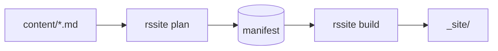
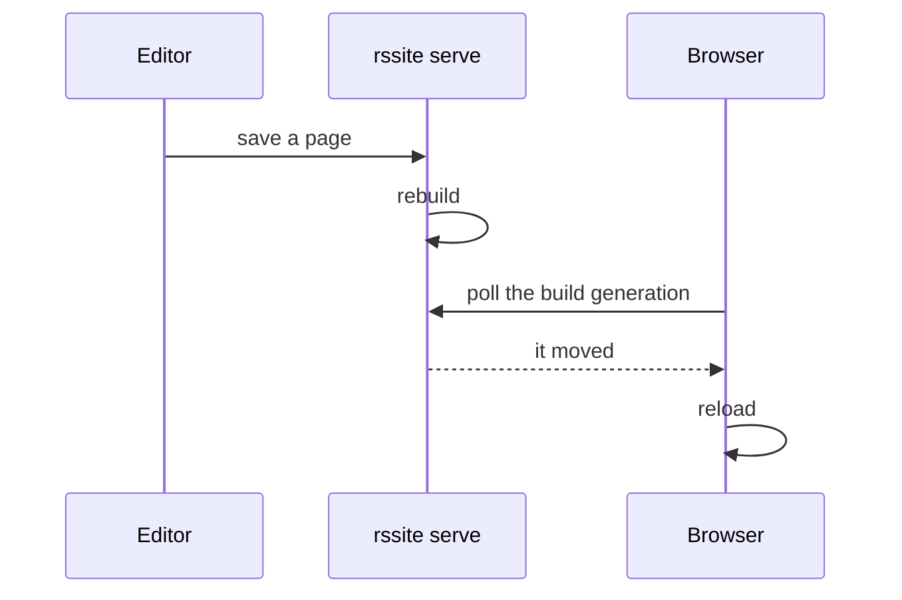

+++
title = "Diagrams"
description = "Mermaid blocks, drawn in the browser."
weight = 7
+++

A fenced block in one of `[markdown] diagram_languages` (`["mermaid"]` by
default) is not highlighted: rssite writes its source into
`<pre class="mermaid">`, and the mermaid.js script in `templates/base.html`
draws it.

## A flowchart



## A sequence diagram



## Another renderer

`diagram_languages = ["mermaid", "dot"]` would leave ` ```dot ` blocks as
`<pre class="dot">` too, for a Graphviz script to draw.
